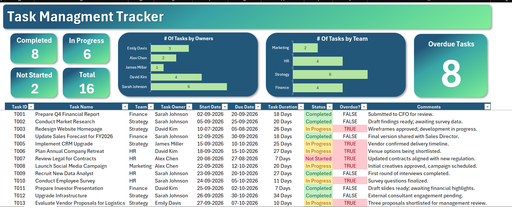

# 📋 Dynamic Task Management Tracker Dashboard

An interactive **Task Management Tracker Dashboard built using Microsoft Excel** to monitor task progress, team performance, task ownership, deadlines, and overdue tasks in one place.

## 📊 Dashboard Preview



## 🎯 Project Overview

This project focuses on simplifying task management through a dynamic Excel dashboard. It provides a clear overview of task status, workload distribution, deadlines, and overdue assignments, helping users monitor progress and organize tasks efficiently.

## 📌 Key Performance Indicators (KPIs)

| KPI | Description |
|---|---|
| ✅ Completed | Number of completed tasks |
| 🔄 In Progress | Number of tasks currently being worked on |
| ⏳ Not Started | Number of tasks that have not yet started |
| 📋 Total Tasks | Total number of tasks being tracked |
| 🚨 Overdue Tasks | Number of tasks identified as overdue |

## 📈 Dashboard Features

### 1. Task Status Monitoring
Tracks tasks across three categories:
- Completed
- In Progress
- Not Started

### 2. Tasks by Owner
Displays the number of tasks assigned to each individual using a horizontal bar chart.

### 3. Tasks by Team
Visualizes task distribution across teams, including:
- Finance
- HR
- Strategy
- Marketing

### 4. Overdue Task Tracking
Highlights overdue tasks to help identify delays and prioritize pending work.

### 5. Detailed Task Tracking Table
Includes the following information:
- Task ID
- Task Name
- Team
- Task Owner
- Start Date
- Due Date
- Task Duration
- Status
- Overdue Indicator
- Comments

### 6. Conditional Formatting
Uses visual formatting to distinguish task statuses and overdue indicators, making important information easier to understand.

### 7. Dynamic Dashboard
Designed to reflect changes in task data and associated calculations or charts when the workbook is updated or refreshed as required.

## 🛠️ Tools & Technologies

- Microsoft Excel
- Excel Tables
- Excel Formulas
- KPI Cards
- Bar Charts
- Conditional Formatting
- Data Validation and Status Tracking
- Data Visualization
- Dashboard Design

## 📂 Project Structure

```text
Excel-Dynamic-Task-Tracker/
│
├── README.md
│
├── Dashboard/
│   └── Task_Management_Tracker.xlsx
│
└── Preview/
    └── dashboard.png
```

## 🚀 How to Use

1. Clone or download this repository.
2. Open the `Dashboard` folder.
3. Download `Task_Management_Tracker.xlsx`.
4. Open the workbook using Microsoft Excel.
5. Explore the KPI cards, charts, and task table.
6. Update task information as required.
7. Recalculate or refresh the workbook where necessary to update the dashboard.

**Note:** GitHub displays the README and dashboard preview, but Excel's interactive features do not run directly on the GitHub page. Download the workbook and open it in Excel to use its functionality.

## 💼 Practical Applications

This dashboard can be used for:
- Project and task tracking
- Team workload monitoring
- Task allocation
- Deadline management
- Progress reporting
- Overdue task identification
- Project performance monitoring

## 🎓 Project Objectives

- Organize task information in a structured format.
- Monitor task completion and progress.
- Visualize task distribution by owner and team.
- Identify overdue tasks and potential delays.
- Present important metrics in a single dashboard.
- Demonstrate Excel-based reporting and data visualization skills.
